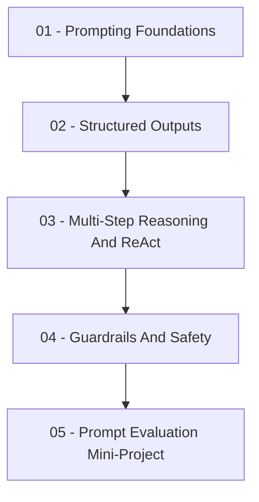

# Prompt Engineering

This repository is a notebook-based learning path for building maintainable
[prompt engineering](https://platform.openai.com/docs/guides/prompting)
workflows with real provider calls. The notebooks use the
[OpenAI Python library](https://github.com/openai/openai-python) with
[Groq](https://console.groq.com/docs) as the primary provider and
[Mistral](https://docs.mistral.ai/) as the alternative provider.

Follow the notebooks in numerical order. Each notebook is self-contained, but
the concepts build from prompt anatomy to
[structured outputs](https://console.groq.com/docs/structured-outputs),
[ReAct-style](https://arxiv.org/abs/2210.03629) tool use,
[guardrails](https://owasp.org/www-project-top-10-for-large-language-model-applications/),
and [prompt evaluation](https://github.com/openai/evals).

## Learning Path



- [01 - Prompting Foundations](01-prompting-foundations.ipynb): Build prompt
  contracts, run
  [zero-shot and few-shot prompts](https://arxiv.org/abs/2005.14165), and
  compare real provider responses.
- [02 - Structured Outputs](02-structured-outputs.ipynb): Use
  [JSON](https://www.json.org/json-en.html)-oriented
  prompting and [Pydantic](https://docs.pydantic.dev/latest/) validation to
  turn model text into trustworthy data.
- [03 - Multi-Step Reasoning And ReAct](03-multi-step-reasoning-and-react.ipynb):
  Build an inspectable reason-act-observe loop with local tools and provider
  calls.
- [04 - Guardrails And Safety](04-guardrails-and-safety.ipynb): Add pre-call and
  post-call checks for
  [prompt injection](https://owasp.org/www-community/attacks/PromptInjection),
  [PII-like input](https://csrc.nist.gov/pubs/sp/800/122/final), off-topic
  requests, and unsafe outputs.
- [05 - Prompt Evaluation Mini-Project](05-prompt-evaluation-mini-project.ipynb):
  Evaluate candidate prompts against a small labeled dataset and write an
  evidence-based improvement report.

## Repository Map

```text
mle-prompt-engineering/
├── assets/                           # local visual aids used in notebooks
├── .env.example                      # provider configuration template
├── requirements.txt                  # runtime dependencies
├── 01-prompting-foundations.ipynb
├── 02-structured-outputs.ipynb
├── 03-multi-step-reasoning-and-react.ipynb
├── 04-guardrails-and-safety.ipynb
└── 05-prompt-evaluation-mini-project.ipynb
```

## Environment

### macOS

```bash
pyenv local 3.11.3
python -m venv .venv
source .venv/bin/activate
python -m pip install --upgrade pip
python -m pip install -r requirements.txt
cp .env.example .env
```

### Windows PowerShell

```powershell
pyenv local 3.11.3
python -m venv .venv
.venv\Scripts\Activate.ps1
python -m pip install --upgrade pip
python -m pip install -r requirements.txt
Copy-Item .env.example .env
```

### Windows Git Bash

```bash
pyenv local 3.11.3
python -m venv .venv
source .venv/Scripts/activate
python -m pip install --upgrade pip
python -m pip install -r requirements.txt
cp .env.example .env
```

## Provider Setup

The notebooks run in dry-run mode when no API key is configured. Dry-run mode
keeps the examples executable, but real prompt behavior requires a provider key.

### Groq Primary Provider

1. Open [Groq API keys](https://console.groq.com/keys).
2. Create an API key.
3. Store it in `.env` as `GROQ_API_KEY`.
4. Keep `LLM_PROVIDER=groq`.

Groq's OpenAI-compatible base URL is documented in
[Groq OpenAI compatibility](https://console.groq.com/docs/openai). Structured
output behavior is documented in
[Groq structured outputs](https://console.groq.com/docs/structured-outputs).

### Mistral Alternative Provider

1. Open [Mistral API keys](https://console.mistral.ai/api-keys).
2. Create an API key in Studio.
3. Store it in `.env` as `MISTRAL_API_KEY`.
4. Set `LLM_PROVIDER=mistral`.

Mistral documents API key management in
[Mistral API keys](https://docs.mistral.ai/admin/security-access/api-keys),
structured outputs in
[Mistral structured outputs](https://docs.mistral.ai/studio-api/conversations/structured-output),
and tool/function calling in
[Mistral function calling](https://docs.mistral.ai/capabilities/function_calling).

## API Usage Notes

- Never commit `.env` or paste real API keys into notebooks.
- Provider free tiers, rate limits, model names, and billing rules can change.
  Check the provider console before running large evaluations.
- The mini-project reads `MAX_EVAL_CASES` from `.env` so you can limit token use
  while testing.
- The notebooks use OpenAI-compatible chat completions through configurable
  `base_url` values rather than provider-specific SDKs.
- Notebook images are sourced English-language diagrams, schemas, or screenshots
  stored as PNG files. Each source page is linked beside the image in its
  notebook.

## Learning Objectives

By the end of this repository, you should be able to:

- Write zero-shot and few-shot prompts that reliably produce structured outputs.
- Design prompts for multi-step reasoning with concise, inspectable final
  outputs.
- Implement a ReAct-style workflow for tasks requiring external information.
- Extract structured data from unstructured text using schema-oriented prompt
  design and validation.
- Design guardrails that constrain LLM outputs to safe, on-topic responses,
  including content filtering, prompt-injection resistance, and PII detection.

## Professional Tooling Context

The notebooks use direct provider calls so the mechanics stay visible. In
production, the same patterns often map to provider and framework features:

- [JSON mode and structured outputs](https://console.groq.com/docs/structured-outputs)
  and [function calling](https://docs.mistral.ai/capabilities/function_calling)
  for schema-constrained responses.
- [LangChain](https://docs.langchain.com/oss/python/langchain/overview) and
  [PydanticAI](https://ai.pydantic.dev/) are examples of frameworks for tool
  routing and orchestration.
- Guardrail services or policy engines for safety checks.
- Evaluation tools such as [Promptfoo](https://www.promptfoo.dev/docs/intro/)
  and [LangSmith](https://docs.smith.langchain.com/evaluation) support
  regression testing and observability.
